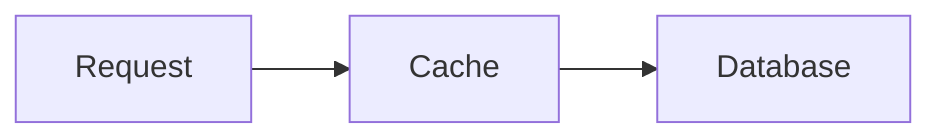

# Inline Visualizer

Render rich visual content — SVG diagrams, HTML interactive widgets, charts — directly inline in a chat conversation. The client renders each visual in a sandboxed iframe once its closing fence has arrived. The result feels like a natural extension of the conversation, not an attachment.

## How it works

You generate raw HTML or SVG fragments. The client renders them in a sandboxed iframe with the design system's CSS variables injected. No `<html>`, `<head>`, or `<body>` tags — just content fragments.

**Two output modes:**

- **SVG mode**: Output starts with `<svg>`. Client auto-wraps in a card. Best for static diagrams.
- **HTML mode**: Raw HTML fragment. Best for interactive content (sliders, tabs, charts, controls). You can embed `<svg>` elements inside HTML mode.

The client detects which mode based on whether the output starts with `<svg`.

## Before generating any visual

Read the design system reference before your first visual in a conversation:

1. **Always read first**: `references/design-system.md` — injected CSS variables, derived tones, typography, core rules
2. **Then read the relevant module**:
   - Diagrams (structural, illustrative, and Mermaid routing): `references/diagrams.md`
   - Interactive explainers, comparisons, data records: `references/components.md`
   - Charts (Chart.js, data viz): `references/charts.md`

Read the design system file once per conversation. Read module files as needed for each visual type.

## Rendering constraints

The client renders a `visualizer` fence only after its closing fence has arrived, so the visual appears whole. Within a visual:

- Flat fills only: no gradients, drop shadows, blur, or glow.
- Prefer inline `style="..."` attributes; keep any `<style>` block under 15 lines.
- Put `<script>` last, so the elements it reads exist when it runs.
- No `<!-- comments -->` or `/* comments */`: they waste tokens.

## Iframe sandbox rules

The visual renders in a sandboxed iframe. These are hard constraints:

- **No localStorage / sessionStorage** — all state must be in-memory
- **No position: fixed** — the iframe auto-sizes to content height; fixed elements collapse it
- **No external fetches** — CSP blocks API calls from inside the widget
- **CDN allowlist only**: `cdnjs.cloudflare.com`, `esm.sh`, `cdn.jsdelivr.net`, `unpkg.com`
- **No DOCTYPE, `<html>`, `<head>`, `<body>`** — just content fragments
- Background is transparent — the host provides the container/card styling
- Colour comes only from the injected variables and tones. The host switches the theme, so the markup never changes between light and dark
- Load libraries via `<script src="https://cdnjs.cloudflare.com/ajax/libs/...">` (UMD globals)

## The sendPrompt bridge

A global `sendPrompt(text)` function is available inside the iframe. It sends a message to the chat as if the user typed it. Use it to make visuals conversational — clicking a node in a diagram can trigger a follow-up explanation.

Use `sendPrompt` when the user's next step benefits from the model thinking. Handle filtering, sorting, toggling, and calculations in local JS instead.

## Choosing the right visual type

Route on the verb, not the noun. The same subject gets different treatment depending on what was asked:

| User says | Type | Fence | What to build |
|-----------|------|-------|---------------|
| "how does X work" | Illustrative diagram | `visualizer` | Spatial metaphor showing the mechanism |
| "what are the components of X" | Structural diagram | `visualizer` | Labelled boxes showing containment |
| "walk me through the steps" | Flowchart | `mermaid` | Mermaid flowchart |
| "how do X and Y talk to each other" | Sequence diagram | `mermaid` | Mermaid sequence diagram |
| "what does the data model look like" | Entity relationship | `mermaid` | Mermaid `erDiagram` |
| "what states can X be in" | State diagram | `mermaid` | Mermaid `stateDiagram-v2` |
| "how are these classes related" | Class diagram | `mermaid` | Mermaid `classDiagram` |
| "compare X vs Y" | Comparison layout | `visualizer` | Side-by-side cards with metrics |
| "show me the data" | Chart | `visualizer` | Chart.js or inline data viz |
| "explain X" (spatial concept) | Interactive explainer | `visualizer` | Sliders, controls, live state |

**Mermaid types use `mermaid` fences, never `visualizer`.** Flowchart, sequence, entity relationship, state and class diagrams are written in a ```` ```mermaid ```` fence using Mermaid syntax. Do not load Mermaid from a CDN, and do not draw these types inside a `visualizer` fence.

Default to illustrative for "how does X work" — it's the more ambitious choice. Don't retreat to a flowchart because it feels safer.

## Multiple visuals per response

Generate multiple visuals in a single response, interleaved with prose:

1. Text block (introduce/explain)
2. Visual
3. Text block (transition)
4. Visual (if needed)

Never stack visuals back-to-back without text between them.

## Output wrapper

Wrap visual output in a code fence with the language tag `visualizer` so the client detects and routes it to the iframe renderer. Use one `visualizer` fence per visual:

````
```visualizer
<svg width="100%" viewBox="0 0 680 400">
  ...
</svg>
```
````

The client renders the fence only after the closing fence arrives. It removes the fence and builds the frame with the theme variables and helper classes added. Write only the fragment inside the fence: no `<html>`, `<head>` or `<body>`.

Mermaid types use a `mermaid` fence with Mermaid syntax instead, not HTML:

````

````

## Quick reference

| Rule | Value |
|------|-------|
| SVG viewBox width | Always 680px |
| Font sizes | 14px labels, 12px subtitles only |
| Stroke width | 0.5px for borders and edges |
| Meaning | Shape, label and line style carry meaning; never colour alone |
| Box subtitle length | ≤5 words |
| Corner radius (SVG) | rx="4" default, rx="8" for emphasis |
| Corner radius (HTML) | `var(--border-radius-md)` or `-lg` |
| Min font size | 11px |
| Text weights | 400 regular, 500 bold only |
| Heading sizes | h1=22px, h2=18px, h3=16px |
